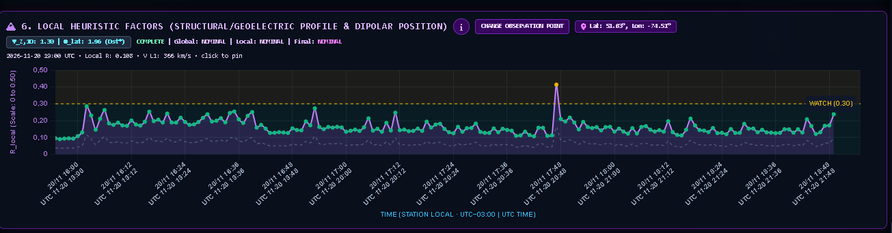

# AlertaSolar

**Autonomous Helio-Geophysical Observation, Academic Simulation & Early Warning SCADA HMI**  
**License:** MIT (Self-Contained Single-File Distribution — Third-Party Libraries Retain Original Licenses)  
**Architecture:** Monolithic Offline-First HTML5 / Vanilla JS (self-contained single-file distribution, SHA-256 integrity metadata)


*Conceptual overview of the complete Sun–Earth–infrastructure workflow. Educational illustration, **not** a screenshot or a source of measured numerical results. The experimental local susceptibility index is a project-developed AlertaSolar heuristic requiring observational calibration.*

---

## 1. Engineering Rationale

AlertaSolar was built from the perspective of a field geologist and an old-school industrial SCADA programmer. The design addresses three operational concerns:
1. When CDNs or external script hosts go down during a communications blackout.
2. When upstream telemetry APIs drop packets and the client silently interpolates across gaps, fabricating false continuity.
3. When solar wind parameters are evaluated in a vacuum, ignoring the lithostratigraphic and geoelectric reality of the Earth's crust at the point of interest.

This system is packaged as a single, self-contained `.html` file. Every dependency required to render the 3D heliosphere, plot tactical time series, compute complex magnetotelluric recursion, typeset analytical equations, and map crustal coordinates (Three.js r128, Chart.js 4.4.1, Leaflet 1.9.4, KaTeX 0.16.8, Marked 11.1.1, Tailwind standalone, Font Awesome 6.4.0) is embedded directly inside the file. The embedded code and assets allow local rendering, propagation and countdown calculations to continue from retained inputs during an internet outage. New telemetry, map tiles and remote notification delivery still require network access; data age and source availability remain visible.

Memory and browser storage are managed with strict byte-level discipline—inherited from 8-bit and early DOS/database engineering. Time-series histories in RAM, `localStorage`, and `IndexedDB` operate on bounded **circular buffers** (e.g., a strict 48-hour rolling window for minute-by-minute L1 telemetry, where each new sample evicts only the oldest record). Persistent operator parameters (NASA API keys, observation coordinates, P-DBM priors, and hardware notification tokens) are isolated in dedicated non-volatile schemas. The design targets continuous operation on ordinary workstations and laptops. Embedded regression suites and a persistent 24-hour performance monitor let reviewers check bounded histories, scheduler behavior, DOM growth and JavaScript heap growth on the actual deployment hardware; see Section 2.2 for the available entry points and the monitor's exact acceptance criteria.

---

## 1.1. Zero-Footprint Control Room Deployment

AlertaSolar is engineered to sit on a standard workstation or laptop on the control room desk—connected solely to corporate or guest Wi-Fi—without requiring IT procurement, cloud subscriptions, or changes to industrial network architecture:

* **Separate Advisory Workstation:** The standalone HMI does not require a connection to plant PLCs, RTUs or control servers and can be deployed on a workstation outside the OT network. Actual network isolation is established by the site's network architecture and operating policy; the live-data workstation uses outbound internet access.
* **Bounded Resource Design:** Circular histories, controlled scheduling and embedded rendering assets support operation on ordinary office hardware. Reviewers can export the built-in 24-hour performance report to assess their own browser, workload and hardware.
* **Optional Browser AI Assistance ("Advisor to the Advisor"):** An operator may use a compatible browser assistant to discuss the HMI's displayed telemetry, crustal context and magnetometer observations. Availability and access to page content depend on that browser's features and permissions. AlertaSolar does not require an AI service, and its HTML distribution does not include a Windows loopback-server script.
* **Blackout Autonomy (`CE_AUTONOMIA_LOCAL`):** If internet connectivity drops during a severe geomagnetic storm, the local state machine takes over seamlessly and continues propagating active CME arrival windows in memory.

### Main Operational HMI — Actual Screenshot


*Actual operational interface showing the heliospheric 3D scene, NOAA bulletins, L1 telemetry status, and real-time supervisory panels. Displayed timestamps, model states and telemetry are a snapshot, not a prediction for the present day.*

---
## 2. Strict Scientific Scope & Physical Boundaries

AlertaSolar is a **glass-box** system: all source code is readable in plain text, every physical equation is documented in the built-in HUDs with its corresponding peer-reviewed DOI, and callable deterministic self-tests, sandboxed regression suites and a persistent 24-hour performance monitor are embedded in the HTML. Section 2.2 identifies their actual JavaScript entry points.

**What this system DOES NOT claim to do:**
* **No fabricated Volts/km or Amperes:** AlertaSolar **never** outputs geoelectric field strength (V/km) or Geomagnetically Induced Currents in Amperes (A) on power grids, transformers, or pipelines. Computing actual currents in conductors requires local surface B(t) vector derivatives coupled with the exact electrical topology of the asset (substation grounding resistances, transformer winding impedances, pipeline coating conductance, and route geometry). Any global software claiming to output Amperes without plant topology is selling smoke.
* **What it actually computes:** It separates upstream L1 forcing (I_global,norm) from local crustal and geomagnetic susceptibility. At the selected observation point, it computes the 1D stratified complex magnetotelluric surface impedance |Z_1D(ω)|, the apparent resistivity ρ_a (Ω·m), the relative litho-geoelectric amplification factor Ψ_Z,1D, the dynamic auroral-oval dipole factor Φ_lat, and a dimensionless local heuristic susceptibility index R_local with entry/exit hysteresis. I_global,norm and the operational R_local are bounded to [0, 1]. The local uncapped diagnostic R_local,raw = I_global,norm × Ψ_Z,1D × Φ_lat is retained separately; the operational output is R_local = min(1, max(0, R_local,raw)).

---

### 2.1. Global Normalization and Local Amplification — Exact Implemented Contract

The global and local indices have different numerical contracts. For each available component, `clip(x) = min(1, max(0, x))`. The global components are Newell coupling, upstream |dBz/dt|, the reconstructed Dst* magnitude and dynamic-pressure forcing, with fixed weights 0.35, 0.35, 0.20 and 0.10 respectively. The implemented global index is:

$$
I_{\mathrm{global,norm}}=\operatorname{clip}\!\left(\frac{\sum_{i\in A}w_i\operatorname{clip}(x_i)}{\sum_{i=1}^{4}w_i}\right),
$$

where A contains the available valid components. Missing contributions are not redistributed among the remaining weights: an eligible partial evaluation is explicitly a provisional lower bound. With insufficient valid components, the result is unavailable rather than a fabricated zero.

For valid coordinates and a computed geo-electrical profile, the two-stage local equation is exactly:

$$
R_{\mathrm{local,raw}}=I_{\mathrm{global,norm}}\,\Psi_{Z,1D}\,\Phi_{\mathrm{lat}},\qquad R_{\mathrm{local}}=\min(1,\max(0,R_{\mathrm{local,raw}})).
$$

The component ratios are `x_Newell = Φ_N / 50000`, `x_IMF = |dBz/dt| / (10 nT/min)`, `x_Dst = |Dst*| / (50 nT)` and `x_pressure = max(0, sqrt(P_dyn,p / (2 nPa)) − 1)`, in the operational units used by the engine. The weights and reference values are internal HMI design parameters.

The geo-electrical multiplier is `Ψ_Z,1D = clip_[0.20, 3.50](sqrt(ρ_a / (100 Ω·m)))`; the dipolar/auroral multiplier is bounded to `[0.20, 2.80]`. **The operational R_local is bounded to [0, 1] by saturation, while R_local,raw retains the uncapped product for each calculated sample.** The historical chart tooltip shows both values. A value of 1 means operational-scale saturation, not a 100% probability of damage, maximum physical severity or measured current. Raw values above 1 remain distinct for analysis even though the operational curve saturates. This is an HMI scaling convention, not a statistical calibration; invalid or missing calculations remain unavailable rather than becoming zero. Internal entry thresholds are 0.30 / 0.60 / 0.90, with exit thresholds 0.25 / 0.50 / 0.80. The existing entry/exit crossings are preserved by capping values above 1. The final level still retains the greater global/local level, and the independent extreme L1 channel is unchanged. These thresholds do not convert the index into measured GIC or a physical damage threshold.

### 2.2. Embedded Verification and 24-Hour Performance Monitoring

The HTML contains executable checks for physical calculations, input validation, source provenance, timing, bounded storage, operational state restoration and scheduler/sandbox isolation. The existing callable entry points are:

| Console entry point | Main verification area |
| --- | --- |
| `runPrompt02SelfTests()` | CME/ENLIL evidence and source contracts |
| `runPrompt03SelfTests()` | L1 validity, continuity and physical-engine contracts |
| `runL1ContinuitySelfTests()` | Historical recovery, 48-hour retention and storage compaction |
| `runPrompt04SelfTests()` | P-DBM solver, deterministic ensemble and traceability |
| `runGicModelSelfTests()` | Main physics and operational regression suite, including sandbox/scheduler isolation |
| `runExtremeContingencySelfTests()` | Extreme-threat state machine, persistence and notification eligibility |
| `runPrompt09SelfTests()` | Additional continuity and operational-state preservation checks |

For an independent review, use a separate browser profile or disposable test copy, disable live PUSH delivery, open Developer Tools → Console, and run the suites sequentially. Await asynchronous calls, for example `await runGicModelSelfTests()` and `await runPrompt09SelfTests()`. Inspect each returned case and console report; the presence of a suite is not a claim that every case passed on every browser or in every release.

`StationPerformanceMonitor` also collects a persistent sample every **15 minutes**, retains at most **97 samples**, and evaluates a **24-hour** observation period. Samples include DOM-node count, JavaScript heap usage when the browser exposes it, scheduler intervals, retained histories and operating state. The implemented non-anomalous-growth criteria are a final/baseline DOM ratio ≤ **1.35** and, when comparable heap measurements are available, a heap ratio ≤ **1.75**. Before the 24-hour duration has elapsed, the result remains in progress. A result without comparable heap measurements does not constitute a heap-leak test.

To inspect the collected report, evaluate `StationPerformanceMonitor.report`; to download its JSON, run `exportStationPerformanceReport()`. These regression and endurance mechanisms provide reproducible evidence of resource behavior under the recorded conditions. Report the artifact hash, browser, hardware, duration and results when making a performance claim; a universal guarantee of zero leaks cannot be inferred from the existence of tests alone.

## 3. Core Physics, Crustal & Telemetry Engines

### 3.1. Deterministic Monte Carlo P-DBM & CME Revision Forensics
* **10,000-Run Ensemble (Vršnak et al., 2013):** Solves the analytical hydrodynamic drag root (`solveArrivalTimeDetailed`) from 21.5 R☉ to 1 AU. Invalid inputs are never masked by ballistic fallbacks.
* **Deterministic Seeding & External Peer Reproducibility:** The Monte Carlo sampler uses a deterministic 32-bit PRNG rather than `Math.random()`. `stableStringifyPDBM` serializes a sorted-key snapshot containing the namespace, CME identifier, `time21_5`, launch epoch, initial speed, half-angle and complete active configuration snapshot, including wind statistics/provenance and drag priors. `pdbmFingerprint` computes its 32-bit FNV-1a fingerprint; that fingerprint is included in the `PDBM_V373` seed string passed to `createMulberry32Prng`. Latitude/longitude govern geometry separately and are not direct fields of this seed snapshot. Reproduction requires the same complete snapshot and implementation, including archive-derived statistics, not merely the same event identifier. The 10,000 requested realizations undergo explicit rejection and acceptance checks before P10/P50/P90 are produced; the embedded P-DBM suite checks repeatability with fixed inputs.
* **Archived Background Solar Wind (`l1_27d`):** Stores quality-controlled L1 speed means in 15-minute bins in `IndexedDB`; each accepted bin requires at least 10 distinct valid minutes. The mode evaluates the 27-day window preceding its reference epoch and the latest six hours within that window. If six-hour coverage is usable, its arithmetic mean sets the center of the wind prior; otherwise, a usable 27-day mean is selected. The pre-truncation standard deviation is the maximum of 20 km/s, the selected window's standard deviation and the 27-day standard deviation when that history is usable. This is not a weighted average of the two means. For an operational CME, the reference is anchored no later than its launch/analysis epoch, preventing subsequent observations from entering that initial prior. Six-hour usability requires at least 12 valid bins and a newest-bin age ≤45 minutes; 27-day usability requires at least 70% of expected bins, minimum coverage in each weekly segment and a newest-bin age ≤24 hours. Insufficient coverage falls back explicitly to the empirical 450 km/s prior. The separate `realtime` option uses a six-hour median/MAD estimator; it must not be confused with the archived mode. The archive references [Napoletano et al. (2022), Section 4.2 and Appendix A3](https://doi.org/10.1029/2021SW002925); binning, coverage controls and fallback rules are implementation choices visible in the code.
* **Full DONKI M2M Revision Tracking:** Instead of overwriting previous measurements, the **Individual CME Progression & Tracking Browse** retains the chronological history of all coronagraph revisions (SOHO LASCO C2/C3, STEREO-A COR2, GOES CCOR-1), distinguishing Leading Edge (`[ACC] PISTA LE`), Shock (`[ACC] REPRESENTANTE SH`), and historical entries (`[HIST]`), alongside raw analyst notes and official NASA CCMC / NOAA WSA-ENLIL impact predictions.
* **Spherical CME–Earth Intersection Classification:** Uses the active DONKI revision's latitude, longitude and half-angle, together with the epoch-dependent heliographic Earth latitude B0, to test whether the Earth direction lies inside the published CME cone. The angular separation is `acos(sin(lat) sin(B0) + cos(lat) cos(B0) cos(lon))`; intersection requires separation ≤half-angle. An internal 5° edge band distinguishes inner-flank from direct intersections without widening the cone. Missing or invalid geometry remains indeterminate. This classification is based on geometry; it does not infer a far-side origin from the absence of a GOES flare, and a geometric intersection alone does not establish arrival time or physical severity.

### 3.2. Embedded 64,800-Cell World Crustal & Geoelectric Matrix (1° × 1°)
* **Zero-Network Geological Lookup:** The entire global 180 × 360 grid (`ALERTASOLAR_GLOBAL_GEOLOGY_GEOELECTRIC_1D_GRID_V2`) is binary-packed in Base64 (`Uint16Array` Little-Endian) inside the HTML.
* **Lithostratigraphic Column (CRUST1.0 & LITHO1.0):** Queries local thicknesses for polar ice, seawater, upper/middle/lower sediments, crystalline upper/middle/lower crust, Moho depth, and lithospheric mantle lid (Laske et al., 2013; Pasyanos et al., 2014), paired with published conductivity priors (Alekseev et al., 2015; Reynolds, 1984).
* **Wait (1954) Complex 1D Recursion (`wait1DResponse`):** Evaluates the stratified electromagnetic transfer function from the asthenospheric half-space up to the surface at the reference period (T = 600 s), cross-auditing the embedded matrix against live complex arithmetic (`matrixRelativeError`) and calculating a ±1 decade conductivity sensitivity envelope. Includes manual 10 km overburden override scenarios (Precambrian shield, cratonic, deep sedimentary basin, mixed infrastructure corridor) clearly labeled as uncalibrated operator hypotheses.

**Conceptual infographic — Global lithostratigraphic model and local geo-electrical response**


*Educational schematic of the 64,800-cell Earth model, local stratified 1D response, and the distinction between normalized global forcing (I_Global) and locally corrected heuristic response (R_Local). Layer thicknesses, conductivities, plots and dates depicted in this artwork are illustrative—not retrieved cell measurements or actual application output. The indices are dimensionless, not measured GIC, amperes or V/km, and are pending independent validation/calibration.*


### 3.3. Upstream L1 Forcing & Dst* ODE Proxy (`buildGicSeries`)
* **Single Immutable Physics Pass:** Reads the retained L1 plasma/MAG history (up to 48 hours in storage) and selects a maximum 24-hour calculation window for `buildGicSeries`. It computes proton dynamic pressure P_dyn,p (nPa), Newell coupling Φ_N (Newell et al., 2007), upstream |dBz/dt| with source-boundary continuity checks, and the Dst* ODE proxy using the [O'Brien & McPherron (2000) parameterization](https://doi.org/10.1029/1998JA000437). The model declares an initial Dst*=0 nT boundary and a 60-minute reconstruction warmup; longer gaps reset the reconstructed segment. It is a modeled ring-current proxy, not an official measured Dst index.
* **Gap & Handover Discipline:** Across short telemetry gaps, the ODE propagates only quiet ring-current decay without fabricating solar wind injection. Active satellite handovers (`SOURCE_HANDOVER`) preserve ODE state while invalidating the single boundary derivative sample.
* **Early Warning Rule:** Dst* warmup requirements never veto or delay an immediate upstream L1 alert when an extreme shock signature arrives.

### 3.4. Regional INTERMAGNET Selection — Up to Four Stations
* When the operator sets an observation point—either via direct Lat/Lon coordinates or by clicking on the interactive **Google Maps Hybrid** view—the system queries its embedded immutable registry of global geomagnetic observatories (`ALERTASOLAR_INTERMAGNET_REGISTRY_V2`).
* The runtime combines the embedded registry with available provider catalog information and evaluates actual usable observations. Great-circle distance and initial bearing (`intermagnetGreatCircleDistanceKm`, `intermagnetInitialBearingDeg`) guide selection of **up to four stations**, prioritizing ONLINE regional observations and seeking an enclosing angular geometry where the available network permits. The map and Chart 7 use the selected stations. If fewer stations are available, the chart shows fewer; delayed/cached regional observations or up to two remote context stations may be displayed with their explicit status and role. Four ONLINE enclosing stations are an objective, not a worldwide availability guarantee. Observations are fetched through **INTERMAGNET GIN** (JSON) and **NRCan/FDSN** (MiniSEED). Each curve represents `sqrt((dX/dt)^2 + (dY/dt)^2)` at its observatory, with distance and data age; it is regional context rather than a triangulated magnetic measurement at the observation point.

**Initial observation point and regional geomagnetic context — Actual screenshot**


*The user selects latitude/longitude, activating the location-dependent crustal context and automatic selection of up to four available geomagnetic observatories, with status and geometry determined from usable observations. The NASA API key field is masked in this screenshot.*


---

## 4. Tactical Observation & Forecast Suite (Charts 1 to 8)

1. **Chart 1 & Table 1b — Solar X-Rays (GOES 0.1–0.8 nm), HF Radio Blackouts & 72h Event Attribution:** Switchable **24 h / 72 h** view combining 1-minute GOES XRS curves, official flare peak catalogs, and NOAA radio burst markers. Table 1b cross-references `edited_events.json` and SWPC bulletins to report the **NOAA Active Region (AR XXXX)** when published and unambiguously attributable; unresolved attribution remains unavailable. It maps **R1–R5 HF Radio Blackout** scales (useful for amateur radio and HF operators), and flags **Type II** (coronal shock sweep with estimated shock velocity in km/s), **Type IV**, and **10.7 cm** radio emissions (explicitly noting that Type II is a shock signature, not an R2 blackout).
2. **Chart 2 — Magnetopause Standoff Compression (Shue et al., 1998):** Live standoff distance R_mp in Earth radii (R_E) vs. the 6.6 R_E geostationary orbit threshold and a ±0.5 R_E operational band. Uses an ionic dynamic pressure input D_p,Shue that incorporates observed He²⁺ alpha ratios (or a declared 4% fallback) while keeping magnetic pressure P_B = B_t² / (2μ₀) strictly separate.
3. **Chart 3 — Observed L1 | Official WSA-ENLIL (Unmixed Provenance):** Plots 1-minute observed L1 velocity and proton density up to the `NOW` cursor, and official NOAA/NASA WSA-ENLIL supercomputer predictions beyond `NOW`, preserving the boundary discontinuity without artificial smoothing, alongside P-DBM / ENLIL arrival markers.
4. **Chart 4 — Planetary Kp Index (Observed | Official Forecast):** Synchronized on the exact same temporal axis as Chart 3 (18 h observed + 72 h forecast), separating published 3-hour NOAA Kp bars from forecasted Kp and G1–G5 storm scales.
5. **Chart 5A — L1 Upstream Kinematics & Ballistic Transit Time (T_imp):** Tracks real-time solar wind speed at L1 and the remaining convective transit minutes from Lagrange L1 to the magnetopause (60 min Early Warning, 30 min Tactical Window, 15 min Imminent Impact).
6. **Chart 5B — Upstream Global Geomagnetic Forcing Proxy (I_global,norm):** Plots the dimensionless L1 composite index and live Dst* readout, supporting provisional lower-bound evaluation when partial components are present.
7. **Chart 6 — Local Heuristic Susceptibility (R_local):** Couples Chart 5B with the local 1D Wait impedance factor Ψ_Z,1D and dipole latitude factor Φ_lat for the selected coordinates, displaying the bounded operational index, retaining its uncapped diagnostic in the historical tooltip, and providing a time cursor synchronized with the estimated ground-arrival time in Chart 7.
8. **Chart 7 — Regional Ground Observation (INTERMAGNET |dB_H/dt|):** Plots minute-by-minute horizontal geomagnetic variation (nT/min) at up to four selected observatories with selectable **Linear** or **Logarithmic-with-Zero (`logzero`)** Y-scales and distance readouts in km.
9. **Chart 8 — Geostationary Satellite Hazard (GOES Electrons >2 MeV):** Collapsible 24-hour logarithmic monitor for relativistic electron flux in e⁻/(cm²·s·sr) responsible for deep dielectric internal charging and sudden Electrostatic Discharge (ESD) in satellites. Tracks both the 1,000 NOAA reference and the 1,500 internal sustained PUSH threshold, warning operators of potential proton contamination during SEP events.

### Selected Tactical Charts — Actual HMI Screenshots

**Solar X-Ray Monitoring and Solar Event Attribution (Chart 1 / Table 1b)**


*GOES X-ray activity, HF radio-blackout reference levels, and the 72-hour event attribution table. Illustrative historical application snapshot; the full tactical suite is described above.*

**Global Upstream Forcing (Chart 5B)**


*The dimensionless, experimental L1-based upstream forcing indicator (I_Global / I_global,norm), with both station-local time and UTC on the horizontal axis. It is not a direct measurement of geomagnetically induced currents.*

**Locally Corrected Heuristic Susceptibility (Chart 6)**



*R_Local shows the location-dependent heuristic response using the selected point's 1D geo-electrical and dipolar factors, with local station time and UTC. The WATCH (0.30) line is an internal operational threshold, not a validated physical GIC limit. The heuristic requires independent observational calibration.*


---

## 5. SCADA Browses & Forensic Telemetry Auditing

* **L1 SCADA Central Telemetry Browse (Min-by-Min):** Inspects every 1-minute plasma/MAG pair over the 48-hour circular buffer (SPEED, DENSITY, BZ, BX, BY, BT, PDYN CALC, TEMP), displaying active satellite source (DSCOVR/ACE/IMAP), pair delta in seconds, quality flags, and explicit `INCOMPLETA` / `N/D` states. Exportable to scientific CSV.
* **Web Connections Telemetry Log (Web connections registers):** Audits remote requests across the HMI's 14 displayed service/link groups, which can involve multiple endpoints and conditional archive queries, logging reception timestamp, service name, exact REST URL, HTTP status code, payload size/record count, latency in ms, and direct vs. CORS fallback routing. If an agency changes an endpoint URL tomorrow, the operator sees the exact failure immediately. Exportable to CSV.
* **Decision Making & Fallbacks Log:** Auditable event log recording every automated source switch, proxy fallback, `ENGINE_RESUMED` gap recovery, and Heliocentric HAPI vector update (STEREO-A, Solar Orbiter, Parker Solar Probe). Exportable to CSV.
* **NOAA Geomagnetic Bulletins Live Feed:** Real-time parser for official SWPC `WATCH`, `WARNING`, and `EXTENDED WARNING` K-index / G-scale bulletins when retrieved in the configured polling cycle.

---

## 6. Local Operational Continuity During Internet Blackouts & Server Overload

During an extreme space-weather event (Carrington-class or severe G4/G5 storm), two failure modes routinely blind standard web dashboards: **global traffic oversaturation** on NOAA/NASA public endpoints (HTTP 502/503/timeouts) and **local internet/satellite link blackouts** at the monitoring station. AlertaSolar retains local calculation and display capabilities under loss of connectivity, using the last available inputs:

* **Extreme Contingency Fail-Safe Latch (`CE_STATES` / `CE_AUTONOMIA_LOCAL`):** The moment an earthbound CME meets extreme kinematics (v ≥ 1,500 km/s inside the impact cone) or an extreme L1 physical signature is captured, the SCADA engine latches the threat state into non-volatile browser storage (`localStorage` / `IndexedDB`).
* **Autonomous Dead-Reckoning Without Internet:** If the local internet connection drops completely or upstream NASA/NOAA servers crash due to global demand, AlertaSolar transitions seamlessly into **Autonomous P-DBM Tracking Mode**. The 3D heliospheric cone propagation, the 10,000-run Monte Carlo arrival probability density (P10, P50, P90), the ballistic L1-to-Earth last-mile countdown, and the local 1D Wait crustal response calculations continue running 100% locally off the internal system clock and the last verified telemetry snapshot.
* **Browser Reload & Power-Cycle Persistence:** When browser storage is available and retained, reopening the same distribution in the same browser/storage context can recover persisted CME parameters and locally retained L1 history without downloading them again. The operator must press **START** and complete the entry confirmation to resume monitoring and countdown operation. Cleared storage, private browsing, storage quotas or a different browser/storage context can limit restoration; retention is up to 48 hours, not a guarantee that every minute was observed or saved.
* **Honest Degradation Signaling & Reconnection Recovery:** While operating in autonomous blackout mode, the HMI explicitly flags stale upstream channels (aged-data and local-continuity states) without fabricating or interpolating fake intermediate telemetry. When internet connectivity returns, the polling engine resynchronizes, suppresses duplicate historical flood alerts, and records the transition and recovery context in the forensic decision log. Valid L1 samples are considered fresh through 10 minutes of age; the service-age degradation notice starts only after that threshold. Physically invalid or missing measurements retain their separate quality states.

---

## 7. Autonomous Group Push Architecture (`ntfy.sh` + Hardware ID Token)

To alert entire engineering teams, control rooms, or family groups simultaneously on their mobile phones without paid corporate gateways or central servers:
1. **Dual-QR Provisioning Modal:** The first QR code directs Android/iOS devices to install the free, open-source `ntfy` app. The second QR code subscribes the device to a unique notification topic (`slug`) deterministically generated from the administrator prefix and a **hexadecimal Hardware ID Token** bound to the host station (e.g., `HELIO-SAT-1D4C` -> `helio_operador_helio_sat_1d4c`). Anyone scanning the station's second QR receives the exact same real-time alerts.
2. **Cross-Tab Delivery Lock:** Uses `navigator.locks` with an `IndexedDB` fallback lock (`AlertaSolar_PUSH_Lock_ES512_EN`) to coordinate delivery between browser tabs sharing the same storage context and suppress duplicate sends; independent computers remain independent publishers.
3. **Operational Push Trigger Matrix (P1 to P17):** Seventeen configurable event types with trigger-specific guards with per-type custom operator notes, delivery priority assignment, cooldown management, and a non-simulating reception verification test:
   * `P1`: New official NOAA/SWPC bulletin published.
   * `P2`: Operational CME window closure (disabled by default; applicable only if a prior high/urgent alert was issued for that CME).
   * `P3`: Confirmed L1 telemetry recovery (after 5 consecutive valid plasma/MAG pairs following a notified degradation).
   * `P4`: Sustained GOES >2 MeV relativistic electrons (≥ 1,500 e⁻/(cm²·s·sr) for 15 min; rearms after 30 min below 1,000).
   * `P5`: Earth-directed CME with v > 1,500 km/s (first snapshot whose unexpanded DONKI cone intersects Earth).
   * `P6` / `P7`: Global (I_global) or Local (R_GIC) index entering Vigilance (≥ 0.30, rearm < 0.25); disabled by default and operator-configurable.
   * `P8`: Confirmed L1 unavailability during a latched extreme CME, subject to the contingency availability gate and a three-minute incident-confirmation timer. The separate service-age notice uses the 10-minute freshness threshold; these are distinct checks.
   * `P9`: Autonomous P-DBM tracking engaged due to remote link loss during an active threat.
   * `P10`: GOES X-ray flare ≥ R2 (M5), escalating only if the same event reaches R4/R5.
   * `P11`: GOES SEP proton radiation storm ≥ S2 (≥ 10 MeV), escalating only on S4/S5.
   * `P12` / `P13`: Global or Local index entering Alert (≥ 0.60, rearm < 0.50).
   * `P14` / `P15`: Global or Local index entering Critical (≥ 0.90, rearm < 0.80).
   * `P16`: Compatible L1 last-mile shock arrival (reports convective transit time to Earth).
   * `P17`: Extreme physical signature observed in a single valid L1 sample (V ≥ 1,500 km/s and B_mag ≥ 50 nT, or 2-of-3 continuous coupled/pressure extreme samples).

---

## 8. Epistemological Transparency & Academic Simulation Laboratory

Beyond its operational role in control rooms, AlertaSolar is designed as an **open educational and epistemological repository** for astrophysics, space-weather, and geophysics students:

* **Self-Contained Scientific HUDs (`[i]` Information Modals):** Every telemetry module, tactical chart, and browse window includes an interactive **`[i]`** button that opens a dedicated scientific Head-Up Display (typeset offline via embedded KaTeX). Instead of hiding behind black-box outputs, these HUDs expose the exact analytical equations, physical variable definitions, unit conversions (e.g., MeV, steradians, nPa, Ω·m), model assumptions, operational limitations, and clickable **peer-reviewed DOIs** (Vršnak et al., 2013; Shue et al., 1998; Newell et al., 2007; O'Brien & McPherron, 2000; Wait, 1954; Laske et al., 2013; Pasyanos et al., 2014; Alekseev et al., 2015). Students and peer reviewers can audit how raw satellite telemetry transforms into physical and heuristic indices step by step.
* **Time-Accelerated Educational CME Simulator:** The local simulator launches a hypothetical CME with adjustable speed, latitude, longitude, half-angle and an L1-blinded scenario. It visualizes propagation, P-DBM countdown, a synthetic L1 discontinuity and theoretical Earth arrival in accelerated time. Synthetic L1 values are explicitly labeled and confined to the educational presentation layer; the simulator does not overwrite the operational NOAA history or turn synthetic values into observed Dst*, Shue or local-index evidence. It supports instruction in propagation and HMI behavior; it is not an end-to-end MHD or GIC validation experiment.
* **Operational Safety Interlock:** To prevent any confusion between academic training and real emergencies, the simulator is governed by a strict hardware-style interlock—it automatically disables and locks itself out whenever a real earthbound critical CME is being tracked by the live SCADA engine.

---

## 9. Quick Start and File Integrity

The repository is being prepared for publication. The HTML distribution is not yet included in the reviewed repository snapshot; documentation and screenshots do not constitute a downloadable application release.

1. Obtain the complete AlertaSolar `.html` distribution from the project maintainer, or from this repository once its release asset is published. Do not substitute the rendered GitHub source page for the actual HTML file.
2. Verify the downloaded file using the matching release-specific checksum below.
3. Open the HTML directly in a modern browser supporting the required WebGL and storage APIs (for example Chrome, Edge, Opera or Brave). No build step or Node.js runtime is required for the standalone distribution. Browser features, storage permissions and remote API access must be checked on the deployment workstation.
4. Select observation coordinates on the map or enter latitude/longitude, configure the NASA access mode and optional `ntfy` receivers, then press **START** and complete the manual entry confirmation. Map tiles, new remote observations and outbound PUSH require connectivity.

### 9.1. Checksums for the Reviewed HTML Artifact

These values identify the exact reviewed file **`AlertaSolar_V5_EN_5.48.html`**, **12,386,273 bytes**. They do not apply to a differently edited or re-encoded HTML, even if its visible version is unchanged.

**Full-file SHA-256 — normal download verification:**

```text
0c31710645ca0292b59a320728021a30813837892cb1804ee4721852df72856e
```

Windows PowerShell:

```powershell
Get-FileHash -Algorithm SHA256 -LiteralPath .\AlertaSolar_V5_EN_5.48.html
```

Linux:

```sh
sha256sum AlertaSolar_V5_EN_5.48.html
```

macOS:

```sh
shasum -a 256 AlertaSolar_V5_EN_5.48.html
```

**Embedded normalized SHA-256 — `artifact-sha256` metadata:**

```text
3b2cd15674d1829a668698802bc76025cd4704174c3de3b38df5163670f58211
```

The embedded value has a different, explicitly declared scope: compute SHA-256 of the complete UTF-8 HTML after replacing **only the 64 hexadecimal characters in the `artifact-sha256` meta value with 64 ASCII zeros**, preserving all other bytes and line endings. This avoids self-reference. A normal full-file checksum must be compared with the first value, not with this normalized value. The metadata declares a checksum; displaying it is not itself a live verification of the file. Verification does not require modifying the saved distribution.

---

## 10. AI-Assisted Development Disclosure

AlertaSolar has been developed under human direction, with the support of generative Artificial Intelligence (AI) tools throughout selected stages of software engineering, code analysis, debugging, technical documentation, and scientific research assistance.

The project's scientific objectives, engineering requirements, physical assumptions, and operational design are established under human responsibility.

AI-generated code, analyses, and recommendations are not regarded as independent scientific evidence or experimental validation. The implemented models remain subject to reproducible testing, critical evaluation against published scientific literature, and observational validation where applicable.

**AI is employed as a supporting engineering and analytical instrument, not as an autonomous scientific authority.**

---

## 11. Third-Party Licenses, Embedded Assets & Data Attribution

AlertaSolar original source code, architecture, and heuristic engines are licensed under the **MIT License**. 

Because the distribution is a monolithic, self-contained `.html` file for offline resilience, it embeds the following open-source libraries and assets (including locally packaged styles, fonts and images), which retain their original licenses and copyrights:
* **Three.js (r128):** Copyright (c) 2010-2021 Three.js authors — **MIT License**.
* **Chart.js (4.4.1) & chartjs-plugin-annotation:** Copyright (c) Chart.js Contributors — **MIT License**.
* **Leaflet (1.9.4):** Copyright (c) 2010-2023, Vladimir Agafonkin; Copyright (c) 2010-2011, CloudMade — **BSD 2-Clause License**.
* **KaTeX (0.16.8):** Copyright (c) 2013-2020 Khan Academy and other contributors — **MIT License** (Code) / **SIL Open Font License 1.1** (Embedded Math Fonts).
* **Marked (11.1.1):** Copyright (c) 2018+, MarkedJS / (c) 2011-2018, Christopher Jeffrey — **MIT License**.
* **Tailwind CSS:** Copyright (c) Tailwind Labs, Inc. — **MIT License**.
* **Font Awesome Free (6.4.0):** Icons licensed under **CC BY 4.0** (Copyright Fonticons, Inc.); Fonts licensed under **SIL OFL 1.1**; Code licensed under **MIT License**.

**Scientific Datasets & Live Telemetry Policies:**
* **NASA DONKI / CDAWeb & NOAA SWPC:** Public domain U.S. federal agency products. AlertaSolar is an independent open-source project and is not endorsed or certified by NASA or NOAA.
* **CRUST1.0 & LITHO1.0 Embedded Matrix:** Derived from open academic crustal and lithospheric models by Laske et al. (2013) and Pasyanos et al. (2014), paired with published rock conductivity priors by Alekseev et al. (2015) and Reynolds (1984).
* **INTERMAGNET & NRCan Ground Magnetometers:** Observations are supplied by the participating institutes and remain subject to their own attribution and use conditions. Consult the applicable [INTERMAGNET data conditions](https://intermagnet.org/data_conditions.html) and [NRCan geomagnetic data information](https://www.spaceweather.gc.ca/data-donnee/geomag/sd-en.php). The software's MIT license does not replace the providers' data terms.

---

## 12. Resumen Sintético (Español)

**AlertaSolar** es un sistema SCADA autónomo de observación heliofísica, acoplamiento magnetosférico, simulación académica y alerta temprana geoeléctrica terrestre, desarrollado bajo filosofía de **caja de cristal** (código 100% auditable bajo licencia MIT) por un geólogo y programador de sistemas SCADA industriales.

* **Empaquetado Monolítico Offline-First:** Todo el código, las bibliotecas gráficas/matemáticas (Three.js, Chart.js, Leaflet, KaTeX, Tailwind), el catálogo mundial de observatorios INTERMAGNET y una matriz global de **64.800 celdas (1° × 1°)** con la estructura cortical y litosférica de **CRUST1.0 y LITHO1.0** están embebidos en un único archivo `.html` sin dependencias externas.
* **Continuidad Local ante Caída de Internet o Sobresaturación de Servidores:** Diseñado para sobrevivir a apagones de conectividad local o al colapso de las APIs públicas de NOAA/NASA por exceso de tráfico mundial durante una tormenta extrema. Una vez capturada y enclavada una amenaza crítica (`CE_STATES` / `v ≥ 1.500 km/s`), si se corta internet o caen los enlaces satelitales, el sistema pasa automáticamente a **Modo de Navegación Autónoma (`CE_AUTONOMIA_LOCAL`)**: mantiene vivos la propagación 3D, el conteo regresivo de arribo P-DBM (P10/P50/P90), el tránsito convectivo de última milla y la evaluación cortical local utilizando el reloj interno y la persistencia no volátil del navegador (con restauración condicionada a la persistencia disponible en el mismo navegador; tras reabrir se requiere START y confirmación manual).
* **Eficiencia de Recursos de Vieja Escuela:** Utiliza motores de borrado circular en memoria y almacenamiento del navegador (`localStorage` / `IndexedDB`) para mantener una ventana histórica de 48 horas de telemetría L1 minuto a minuto con pruebas de regresión embebidas y un monitor persistente de rendimiento de 24 horas que registra crecimiento del DOM, memoria JavaScript cuando está disponible y actividad del planificador; sus resultados deben evaluarse en el equipo y navegador utilizados.
* **Rigor Físico, Reproducibilidad Determinista y Honestidad Científica:** Integra propagación probabilística **P-DBM de 10.000 iteraciones deterministas** (Vršnak et al., 2013) con fingerprint **FNV-1a de 32 bits**, snapshot canónico (`stableStringifyPDBM`) y generador determinista. La reproducción exige la misma implementación y el snapshot completo de entradas, configuración y estadísticas históricas, además de la revisión DONKI. El modo de viento de 27 días usa medias de intervalos de 15 minutos: prioriza la media de las seis horas previas a la referencia de la CME y conserva la dispersión histórica cuando hay cobertura suficiente; mediana/MAD corresponde a la opción alternativa de seis horas. Acopla compresión de magnetopausa (Shue et al., 1998), función de Newell et al. (2007), integración ODE del proxy Dst* (O'Brien y McPherron, 2000), recursión magnetotelúrica compleja 1D de **Wait (1954)** sobre conductividades corticales (Alekseev et al., 2015) y selección regional de **hasta cuatro magnetómetros** disponibles, priorizando observaciones en línea y geometría envolvente cuando la red lo permite; cada estación aporta una observación regional y no una medición interpolada del punto. La clasificación CME–Tierra usa la intersección del cono DONKI con la dirección terrestre mediante trigonometría esférica; no depende de la ausencia de una fulguración. Por honestidad científica estricta, el sistema **jamás afirma calcular campo geoeléctrico en V/km ni corrientes en Amperios (A)** en redes o ductos, entregando en su lugar la impedancia superficial compleja |Z_1D(ω)|, los factores de amplificación local y dos índices adimensionales distintos: I_global,norm y R_local operativos limitados a [0, 1]. Se conserva R_local,raw = I_global,norm × Ψ_Z,1D × Φ_lat como diagnóstico sin recorte; la salida operativa aplica R_local = min(1, max(0, R_local,raw)). El tooltip histórico muestra ambos valores. Un valor operativo 1 significa saturación de escala, no probabilidad de daño ni severidad física máxima; los umbrales e histéresis existentes se conservan.
* **Reservorio Epistemológico y Laboratorio Educativo (`[i]` HUDs y Simulador CME):** Cada módulo y gráfico táctico incorpora botones de información **`[i]`** que despliegan HUDs científicos autocontenidos con las ecuaciones analíticas (renderizadas offline vía KaTeX), diccionarios de variables, límites de validez y enlaces DOI a la literatura revisada por pares. Incluye además un **simulador educativo de CMEs en tiempo acelerado**, con discontinuidad L1 sintética identificada y separada del historial operativo NOAA; no constituye una validación MHD/GIC integral. Un enclavamiento lo bloquea ante una CME real clasificada como crítica.
* **Auditoría Forense y Notificaciones Push Grupales:** Incluye 8 paneles gráficos tácticos (con atribución de llamaradas solares de 24/72 h por región activa AR, apagones de radio HF R1–R5, emisiones de radio Tipo II/IV y flujo de electrones relativistas >2 MeV en GEO), 4 visores Browse exportables a CSV (progresión de revisiones DONKI, telemetría L1 minuto a minuto, bitácora de decisiones/fallbacks y registro de latencia/HTTP de los 14 grupos de servicios/enlaces mostrados, con múltiples endpoints según la consulta) y un motor de notificaciones móviles vía `ntfy.sh` con doble código QR, token hexadecimal de hardware por estación y matriz de 17 disparadores operativos (P1 a P17).