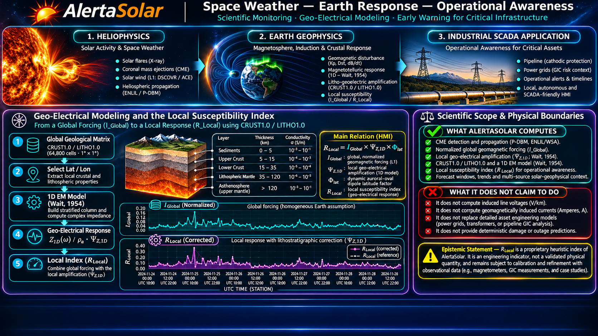

# AlertaSolar

**Autonomous Helio-Geophysical Observation, Academic Simulation & Early Warning SCADA HMI**  
**License:** MIT (Self-Contained Single-File Distribution — Third-Party Libraries Retain Original Licenses)  
**Architecture:** Monolithic Offline-First HTML5 / Vanilla JS (self-contained single-file distribution, SHA-256 integrity metadata)

*Conceptual overview of the complete Sun–Earth–infrastructure workflow. Educational illustration, **not** a screenshot or a source of measured numerical results. The experimental local susceptibility index is a proprietary AlertaSolar heuristic requiring observational calibration.*

---

## 1. Engineering Rationale

AlertaSolar was built from the perspective of a field geologist and an old-school industrial SCADA programmer. Most modern space-weather dashboards are cloud-dependent web wrappers that fail under three conditions:
1. When CDNs or external script hosts go down during a communications blackout.
2. When upstream telemetry APIs drop packets and the client silently interpolates across gaps, fabricating false continuity.
3. When solar wind parameters are evaluated in a vacuum, ignoring the lithostratigraphic and geoelectric reality of the Earth's crust at the point of interest.

This system is packaged as a single, self-contained `.html` file. Every dependency required to render the 3D heliosphere, plot tactical time series, compute complex magnetotelluric recursion, typeset analytical equations, and map crustal coordinates (Three.js r128, Chart.js 4.4.1, Leaflet 1.9.4, KaTeX 0.16.8, Marked 11.1.1, Tailwind standalone, Font Awesome 6.4.0) is embedded directly inside the file. If the internet connection drops in the middle of a severe geomagnetic event, the HMI does not crash, lose its state, or stop running its local propagation and countdown engines.

Memory and browser storage are managed with strict byte-level discipline—inherited from 8-bit and early DOS/database engineering. Time-series histories in RAM, `localStorage`, and `IndexedDB` operate on bounded **circular buffers** (e.g., a strict 48-hour rolling window for minute-by-minute L1 telemetry, where each new sample evicts only the oldest record). Persistent operator parameters (NASA API keys, observation coordinates, P-DBM priors, and hardware notification tokens) are isolated in dedicated non-volatile schemas. The system can run 24/7 on modest hardware (including an Intel Celeron) with a flat memory footprint and zero memory leaks.

---

## 1.1. Zero-Footprint Control Room Deployment

AlertaSolar is engineered to sit on a standard workstation or laptop on the control room desk—connected solely to corporate or guest Wi-Fi—without requiring IT procurement, cloud subscriptions, or changes to industrial network architecture:

* **True OT Air-Gap Compliance:** Runs completely isolated from the plant's SCADA/ICS network. Zero inbound ports, zero external executables, and zero attack surface over PLCs, RTUs, or control servers.
* **Legacy Hardware Ready:** Executes smoothly 24/7 with deterministic circular RAM buffers on modest office laptops (including 15-year-old Intel Celeron CPUs).
* **Live DOM AI Co-Pilot ("Advisor to the Advisor"):** Launching via the included native Windows loopback script (`http://127.0.0.1:8080/`) allows Chrome's Gemini side panel to read live telemetry, local crustal impedance (`CRUST1.0`), and magnetometer data directly from the DOM—giving shift operators plain-language physical context so they don't chase telluric transients with manual cathodic protection adjustments.
* **Blackout Autonomy (`CE_AUTONOMIA_LOCAL`):** If internet connectivity drops during a severe geomagnetic storm, the local state machine takes over seamlessly and continues propagating active CME arrival windows in memory.

### Main Operational HMI — Actual Screenshot

*Actual operational interface showing the heliospheric 3D scene, NOAA bulletins, L1 telemetry status, and real-time supervisory panels. Displayed timestamps, model states and telemetry are a snapshot, not a prediction for the present day.*

---
## 2. Strict Scientific Scope & Physical Boundaries

AlertaSolar is a **glass-box** system: all source code is readable in plain text, every physical equation is documented in the built-in HUDs with its corresponding peer-reviewed DOI, and over 4,300 lines of deterministic self-tests and sandboxed regression suites are included at the bottom of the file.

**What this system DOES NOT claim to do:**
* **No fabricated Volts/km or Amperes:** AlertaSolar **never** outputs induced line voltages (V/km) or Geomagnetically Induced Currents in Amperes (A) on power grids, transformers, or pipelines. Computing actual currents in conductors requires local surface B(t) vector derivatives coupled with the exact electrical topology of the asset (substation grounding resistances, transformer winding impedances, pipeline coating conductance, and route geometry). Any global software claiming to output Amperes without plant topology is selling smoke.
* **What it actually computes:** It separates upstream L1 forcing (I_global,norm) from local crustal and geomagnetic susceptibility. At the selected observation point, it computes the 1D stratified complex magnetotelluric surface impedance |Z_1D(ω)|, the apparent resistivity ρ_a (Ω·m), the relative litho-geoelectric amplification factor Ψ_Z,1D, the dynamic auroral-oval dipole factor Φ_lat, and a normalized dimensionless heuristic susceptibility index (0.00 – 1.00) with entry/exit hysteresis.

---

## 3. Core Physics, Crustal & Telemetry Engines

### 3.1. Deterministic Monte Carlo P-DBM & CME Revision Forensics
* **10,000-Run Ensemble (Vršnak et al., 2013):** Solves the analytical hydrodynamic drag root (`solveArrivalTimeDetailed`) from 21.5 R☉ to 1 AU. Invalid inputs are never masked by ballistic fallbacks.
* **FNV-1a Deterministic Seeding & External Peer Reproducibility:** Standard `Math.random()` is strictly prohibited in the propagation engine. Instead, the PRNG seed is deterministically computed via a 32-bit FNV-1a hash over a lexicographically sorted canonical JSON snapshot (`stableStringify`) containing the exact DONKI CME revision parameters (`activityID`, start time, initial speed v₀, half-angle, lat/lon) and active model priors (`PDBM_V373`, ambient solar wind speed w, and drag parameter γ). Any external reviewer loading the same DONKI revision and background solar wind priors on a different machine—or invoking the engine via the browser developer console (`F12`) against the embedded regression test vectors at the bottom of the file—will obtain the exact same 32-bit seed, identical 10,000 (γ_i, w_i) realizations, and identical P10, P50, and P90 arrival timestamps down to the second.
* **Robust Background Solar Wind (`l1_27d`):** Estimates ambient solar wind speed w from a 27-day L1 rolling archive in `IndexedDB` using the median and Median Absolute Deviation (MAD) to prevent transient CME spikes from corrupting the background drag calculation.
* **Full DONKI M2M Revision Tracking:** Instead of overwriting previous measurements, the **Individual CME Progression & Tracking Browse** retains the chronological history of all coronagraph revisions (SOHO LASCO C2/C3, STEREO-A COR2, GOES CCOR-1), distinguishing Leading Edge (`[ACC] PISTA LE`), Shock (`[ACC] REPRESENTANTE SH`), and historical entries (`[HIST]`), alongside raw analyst notes and official NASA CCMC / NOAA WSA-ENLIL impact predictions.
* **Far-Side False Alarm Filter:** Cross-checks DONKI CME detections against GOES X-ray flare activity within the launch window to flag potential far-side halo events.

### 3.2. Embedded 64,800-Cell World Crustal & Geoelectric Matrix (1° × 1°)
* **Zero-Network Geological Lookup:** The entire global 180 × 360 grid (`ALERTASOLAR_GLOBAL_GEOLOGY_GEOELECTRIC_1D_GRID_V2`) is binary-packed in Base64 (`Uint16Array` Little-Endian) inside the HTML.
* **Lithostratigraphic Column (CRUST1.0 & LITHO1.0):** Queries local thicknesses for polar ice, seawater, upper/middle/lower sediments, crystalline upper/middle/lower crust, Moho depth, and lithospheric mantle lid (Laske et al., 2013; Pasyanos et al., 2014), paired with published conductivity priors (Alekseev et al., 2015; Reynolds, 1984).
* **Wait (1954) Complex 1D Recursion (`wait1DResponse`):** Evaluates the stratified electromagnetic transfer function from the asthenospheric half-space up to the surface at the reference period (T = 600 s), cross-auditing the embedded matrix against live complex arithmetic (`matrixRelativeError`) and calculating a ±1 decade conductivity sensitivity envelope. Includes manual 10 km overburden override scenarios (Precambrian shield, cratonic, deep sedimentary basin, mixed infrastructure corridor) clearly labeled as uncalibrated operator hypotheses.

**Conceptual infographic — Global lithostratigraphic model and local geo-electrical response**

*Educational schematic of the 64,800-cell Earth model, local stratified 1D response, and the distinction between normalized global forcing (I_Global) and locally corrected heuristic response (R_Local). Layer thicknesses, conductivities, plots and dates depicted in this artwork are illustrative—not retrieved cell measurements or actual application output. The indices are dimensionless, not measured GIC, amperes or V/km, and are pending independent validation/calibration.*

### 3.3. Upstream L1 Forcing & Dst* ODE Proxy (`buildGicSeries`)
* **Single Immutable Physics Pass:** Processes the 48-hour L1 plasma and magnetometer series (DSCOVR / ACE / IMAP) to compute proton dynamic pressure P_dyn,p (nPa), Newell magnetospheric coupling Φ_N (Newell et al., 2007), L1 |dBz/dt| with strict source-boundary continuity checks, and the Burton-McPherron-Russell Dst* ODE ring-current proxy (Burton et al., 1975).
* **Gap & Handover Discipline:** Across short telemetry gaps, the ODE propagates only quiet ring-current decay without fabricating solar wind injection. Active satellite handovers (`SOURCE_HANDOVER`) preserve ODE state while invalidating the single boundary derivative sample.
* **Early Warning Rule:** Dst* warmup requirements never veto or delay an immediate upstream L1 alert when an extreme shock signature arrives.

### 3.4. Azimuthal 4-Station INTERMAGNET Triangulation
* When the operator sets an observation point—either via direct Lat/Lon coordinates or by clicking on the interactive **Google Maps Hybrid** view—the system queries its embedded immutable registry of global geomagnetic observatories (`ALERTASOLAR_INTERMAGNET_REGISTRY_V2`).
* Using great-circle distance and initial bearing (`intermagnetGreatCircleDistanceKm`, `intermagnetInitialBearingDeg`) across a spherical region matrix, it automatically selects a surrounding quartet of **4 magnetometers** to enclose the target, fetching live horizontal magnetic variation |dB_H/dt| (nT/min) via **INTERMAGNET GIN** (JSON) and **NRCan/FDSN** (binary MiniSEED), while explicitly distinguishing **ONLINE** stations from **OFFLINE** stations with delayed/stale data.

**Initial observation point and regional geomagnetic context — Actual screenshot**

*The user selects latitude/longitude, activating the location-dependent crustal context and automatic selection of four surrounding geomagnetic observatories. The NASA API key field is masked in this screenshot.*

---

## 4. Tactical Observation & Forecast Suite (Charts 1 to 8)

1. **Chart 1 & Table 1b — Solar X-Rays (GOES 0.1–0.8 nm), HF Radio Blackouts & 72h Event Attribution:** Switchable **24 h / 72 h** view combining 1-minute GOES XRS curves, official flare peak catalogs, and NOAA radio burst markers. Table 1b cross-references `edited_events.json` and SWPC bulletins to attribute flares to their exact **NOAA Active Region (AR XXXX)**, maps **R1–R5 HF Radio Blackout** scales (useful for amateur radio and HF operators), and flags **Type II** (coronal shock sweep with estimated shock velocity in km/s), **Type IV**, and **10.7 cm** radio emissions (explicitly noting that Type II is a shock signature, not an R2 blackout).
2. **Chart 2 — Magnetopause Standoff Compression (Shue et al., 1998):** Live standoff distance R_mp in Earth radii (R_E) vs. the 6.6 R_E geostationary orbit threshold and a ±0.5 R_E operational band. Uses an ionic dynamic pressure input D_p,Shue that incorporates observed He²⁺ alpha ratios (or a declared 4% fallback) while keeping magnetic pressure P_B = B_t² / (2μ₀) strictly separate.
3. **Chart 3 — Observed L1 | Official WSA-ENLIL (Unmixed Provenance):** Plots 1-minute observed L1 velocity and proton density up to the `NOW` cursor, and official NOAA/NASA WSA-ENLIL supercomputer predictions beyond `NOW`, preserving the boundary discontinuity without artificial smoothing, alongside P-DBM / ENLIL arrival markers.
4. **Chart 4 — Planetary Kp Index (Observed | Official Forecast):** Synchronized on the exact same temporal axis as Chart 3 (18 h observed + 72 h forecast), separating published 3-hour NOAA Kp bars from forecasted Kp and G1–G5 storm scales.
5. **Chart 5A — L1 Upstream Kinematics & Ballistic Transit Time (T_imp):** Tracks real-time solar wind speed at L1 and the remaining convective transit minutes from Lagrange L1 to the magnetopause (60 min Early Warning, 30 min Tactical Window, 15 min Imminent Impact).
6. **Chart 5B — Upstream Global Geomagnetic Forcing Proxy (I_global,norm):** Plots the dimensionless L1 composite index and live Dst* readout, supporting provisional lower-bound evaluation when partial components are present.
7. **Chart 6 — Local Heuristic Susceptibility (R_local):** Couples Chart 5B with the local 1D Wait impedance factor Ψ_Z,1D and dipole latitude factor Φ_lat for the selected coordinates, displaying a time cursor synchronized with ground arrival in Chart 7.
8. **Chart 7 — Regional Ground Confirmation (INTERMAGNET |dB_H/dt|):** Plots minute-by-minute horizontal geomagnetic variation (nT/min) across the 4 surrounding observatories with selectable **Linear** or **Logarithmic-with-Zero (`logzero`)** Y-scales and distance readouts in km.
9. **Chart 8 — Geostationary Satellite Hazard (GOES Electrons >2 MeV):** Collapsible 24-hour logarithmic monitor for relativistic electron flux in e⁻/(cm²·s·sr) responsible for deep dielectric internal charging and sudden Electrostatic Discharge (ESD) in satellites. Tracks both the 1,000 NOAA reference and the 1,500 internal sustained PUSH threshold, warning operators of potential proton contamination during SEP events.

### Selected Tactical Charts — Actual HMI Screenshots

**Solar X-Ray Monitoring and Solar Event Attribution (Chart 1 / Table 1b)**

*GOES X-ray activity, HF radio-blackout reference levels, and the 72-hour event attribution table. Illustrative historical application snapshot; the full tactical suite is described above.*

**Global Upstream Forcing (Chart 5B)**

*The dimensionless, experimental L1-based upstream forcing indicator (I_Global / I_global,norm), with both station-local time and UTC on the horizontal axis. It is not a direct measurement of geomagnetically induced currents.*

**Locally Corrected Heuristic Susceptibility (Chart 6)**

*R_Local shows the location-dependent heuristic response using the selected point's 1D geo-electrical and dipolar factors, with local station time and UTC. The WATCH (0.30) line is an internal operational threshold, not a validated physical GIC limit. The heuristic requires independent observational calibration.*

---

## 5. SCADA Browses & Forensic Telemetry Auditing

* **L1 SCADA Central Telemetry Browse (Min-by-Min):** Inspects every 1-minute plasma/MAG pair over the 48-hour circular buffer (SPEED, DENSITY, BZ, BX, BY, BT, PDYN CALC, TEMP), displaying active satellite source (DSCOVR/ACE/IMAP), pair delta in seconds, quality flags, and explicit `INCOMPLETA` / `N/D` states. Exportable to scientific CSV.
* **Web Connections Telemetry Log (Web connections registers):** Monitors all 14 remote endpoints polled at different cadences, logging reception timestamp, service name, exact REST URL, HTTP status code, payload size/record count, latency in ms, and direct vs. CORS fallback routing. If an agency changes an endpoint URL tomorrow, the operator sees the exact failure immediately. Exportable to CSV.
* **Decision Making & Fallbacks Log:** Auditable event log recording every automated source switch, proxy fallback, `ENGINE_RESUMED` gap recovery, and Heliocentric HAPI vector update (STEREO-A, Solar Orbiter, Parker Solar Probe). Exportable to CSV.
* **NOAA Geomagnetic Bulletins Live Feed:** Real-time parser for official SWPC `WATCH`, `WARNING`, and `EXTENDED WARNING` K-index / G-scale bulletins as soon as they are issued.

---

## 6. Absolute Operational Autonomy During Internet Blackouts & Server Overload

During an extreme space-weather event (Carrington-class or severe G4/G5 storm), two failure modes routinely blind standard web dashboards: **global traffic oversaturation** on NOAA/NASA public endpoints (HTTP 502/503/timeouts) and **local internet/satellite link blackouts** at the monitoring station. AlertaSolar is engineered as an autonomous survival instrument under total loss of connectivity:

* **Extreme Contingency Fail-Safe Latch (`CE_STATES` / `CE_AUTONOMIA_LOCAL`):** The moment an earthbound CME meets extreme kinematics (v ≥ 1,500 km/s inside the impact cone) or an extreme L1 physical signature is captured, the SCADA engine latches the threat state into non-volatile browser storage (`localStorage` / `IndexedDB`).
* **Autonomous Dead-Reckoning Without Internet:** If the local internet connection drops completely or upstream NASA/NOAA servers crash due to global demand, AlertaSolar transitions seamlessly into **Autonomous P-DBM Tracking Mode**. The 3D heliospheric cone propagation, the 10,000-run Monte Carlo arrival probability density (P10, P50, P90), the ballistic L1-to-Earth last-mile countdown, and the local 1D Wait crustal response calculations continue running 100% locally off the internal system clock and the last verified telemetry snapshot.
* **Browser Reload & Power-Cycle Persistence:** Even if the operator accidentally closes the browser tab or the workstation suffers a power reboot while the internet is still down, reopening the local `.html` file restores the latched CME parameters, the 48-hour circular telemetry buffer, and the active P-DBM countdown from local storage without requiring a single byte of external network traffic.
* **Honest Degradation Signaling & Reconnection Recovery:** While operating in autonomous blackout mode, the HMI explicitly flags stale upstream channels (`DEGRADADA` / `AUTONOMIA P-DBM`) without fabricating or interpolating fake intermediate telemetry. When internet connectivity returns, the polling engine resynchronizes, suppresses duplicate historical flood alerts, and logs the exact duration of the autonomous window in the forensic decision log.

---

## 7. Autonomous Group Push Architecture (`ntfy.sh` + Hardware ID Token)

To alert entire engineering teams, control rooms, or family groups simultaneously on their mobile phones without paid corporate gateways or central servers:
1. **Dual-QR Provisioning Modal:** The first QR code directs Android/iOS devices to install the free, open-source `ntfy` app. The second QR code subscribes the device to a unique notification topic (`slug`) deterministically generated from the administrator prefix and a **hexadecimal Hardware ID Token** bound to the host station (e.g., `HELIO-SAT-1D4C` -> `helio_operador_helio_sat_1d4c`). Anyone scanning the station's second QR receives the exact same real-time alerts.
2. **Cross-Tab Delivery Lock:** Uses `navigator.locks` with an `IndexedDB` fallback lock (`AlertaSolar_PUSH_Lock_ES512`) so multiple open browser tabs never fire duplicate push notifications.
3. **Operational Push Trigger Matrix (P1 to P17):** Seventeen independent, hysteresis-guarded triggers with per-type custom operator notes, delivery priority assignment, cooldown management, and a non-simulating reception verification test:
   * `P1`: New official NOAA/SWPC bulletin published.
   * `P2`: Operational CME window closure (only if a prior high/urgent alert was issued for that CME).
   * `P3`: Confirmed L1 telemetry recovery (after 5 consecutive valid plasma/MAG pairs following a notified degradation).
   * `P4`: Sustained GOES >2 MeV relativistic electrons (≥ 1,500 e⁻/(cm²·s·sr) for 15 min; rearms after 30 min below 1,000).
   * `P5`: Earth-directed CME with v > 1,500 km/s (first snapshot whose unexpanded DONKI cone intersects Earth).
   * `P6` / `P7`: Global (I_global) or Local (R_GIC) index entering Vigilance (≥ 0.30, rearm < 0.25).
   * `P8`: L1 telemetry degraded during a latched extreme CME (3 consecutive minutes without a valid plasma/MAG pair).
   * `P9`: Autonomous P-DBM tracking engaged due to remote link loss during an active threat.
   * `P10`: GOES X-ray flare ≥ R2 (M5), escalating only if the same event reaches R4/R5.
   * `P11`: GOES SEP proton radiation storm ≥ S2 (≥ 10 MeV), escalating only on S4/S5.
   * `P12` / `P13`: Global or Local index entering Alert (≥ 0.60, rearm < 0.50).
   * `P14` / `P15`: Global or Local index entering Critical (≥ 0.90, rearm < 0.80).
   * `P16`: Compatible L1 last-mile shock arrival (reports convective transit time to Earth).
   * `P17`: Extreme physical signature observed in a single valid L1 sample (V ≥ 1,500 km/s and B_mag ≥ 50 nT, or 2-of-3 continuous coupled/pressure extreme samples).

---

## 8. Epistemological Transparency & Academic Simulation Laboratory

Beyond its operational role in control rooms, AlertaSolar is designed as an **open educational and epistemological repository** for astrophysics, space-weather, and geophysics students:

* **Self-Contained Scientific HUDs (`[i]` Information Modals):** Every telemetry module, tactical chart, and browse window includes an interactive **`[i]`** button that opens a dedicated scientific Head-Up Display (typeset offline via embedded KaTeX). Instead of hiding behind black-box outputs, these HUDs expose the exact analytical equations, physical variable definitions, unit conversions (e.g., MeV, steradians, nPa, Ω·m), model assumptions, operational limitations, and clickable **peer-reviewed DOIs** (Vršnak et al., 2013; Shue et al., 1998; Newell et al., 2007; Burton et al., 1975; Wait, 1954; Laske et al., 2013; Pasyanos et al., 2014; Alekseev et al., 2015). Students and peer reviewers can audit how raw satellite telemetry transforms into physical and heuristic indices step by step.
* **Time-Accelerated Extreme CME Simulator:** Severe earthbound coronal mass ejections (v ≥ 1,500–2,500 km/s) are rare across a solar cycle. The built-in 3D and telemetry simulator allows professors, students, and operators to inject hypothetical high-hazard CMEs in accelerated time, observing the complete causal chain: 3D cone expansion across the inner heliosphere, P-DBM deceleration, L1 shock arrival, magnetopause compression below geostationary orbit (6.6 R_E), ring-current Dst* depression, and the resulting local crustal response across different geological provinces.
* **Operational Safety Interlock:** To prevent any confusion between academic training and real emergencies, the simulator is governed by a strict hardware-style interlock—it automatically disables and locks itself out whenever a real earthbound critical CME is being tracked by the live SCADA engine.

---

## 9. Quick Start

1. Download the current AlertaSolar `.html` distribution from this repository.
2. Verify file integrity against the `artifact-sha256` meta tag in the HTML header if deploying in an audited environment.
3. Open the file directly in any modern Chromium-based or standards-compliant browser (Chrome, Edge, Opera, Brave). No web server, Node.js runtime, or build step is required.
4. Select your observation coordinates on the hybrid map (or enter Lat/Lon), configure your NASA API key (or run in public fallback mode), explore the **`[i]`** scientific HUDs, and optionally scan the `ntfy` QR code to link mobile receivers.

---

## 10. AI-Assisted Development Disclosure

AlertaSolar has been developed under human direction, with the support of generative Artificial Intelligence (AI) tools throughout selected stages of software engineering, code analysis, debugging, technical documentation, and scientific research assistance.

The project's scientific objectives, engineering requirements, physical assumptions, and operational design are established under human responsibility.

AI-generated code, analyses, and recommendations are not regarded as independent scientific evidence or experimental validation. The implemented models remain subject to reproducible testing, critical evaluation against published scientific literature, and observational validation where applicable.

**AI is employed as a supporting engineering and analytical instrument, not as an autonomous scientific authority.**

---

## 11. Third-Party Licenses, Embedded Assets & Data Attribution

AlertaSolar original source code, architecture, and heuristic engines are licensed under the **MIT License**. 

Because the distribution is a monolithic, self-contained `.html` file for offline resilience, it embeds unmodified copies of the following open-source libraries, which retain their original licenses and copyrights:
* **Three.js (r128):** Copyright (c) 2010-2021 Three.js authors — **MIT License**.
* **Chart.js (4.4.1) & chartjs-plugin-annotation:** Copyright (c) Chart.js Contributors — **MIT License**.
* **Leaflet (1.9.4):** Copyright (c) 2010-2023, Vladimir Agafonkin; Copyright (c) 2010-2011, CloudMade — **BSD 2-Clause License**.
* **KaTeX (0.16.8):** Copyright (c) 2013-2020 Khan Academy and other contributors — **MIT License** (Code) / **SIL Open Font License 1.1** (Embedded Math Fonts).
* **Marked (11.1.1):** Copyright (c) 2018+, MarkedJS / (c) 2011-2018, Christopher Jeffrey — **MIT License**.
* **Tailwind CSS:** Copyright (c) Tailwind Labs, Inc. — **MIT License**.
* **Font Awesome Free (6.4.0):** Icons licensed under **CC BY 4.0** (Copyright Fonticons, Inc.); Fonts licensed under **SIL OFL 1.1**; Code licensed under **MIT License**.

**Scientific Datasets & Live Telemetry Policies:**
* **NASA DONKI / CDAWeb & NOAA SWPC:** Public domain U.S. federal agency products. AlertaSolar is an independent open-source project and is not endorsed or certified by NASA or NOAA.
* **CRUST1.0 & LITHO1.0 Embedded Matrix:** Derived from open academic crustal and lithospheric models by Laske et al. (2013) and Pasyanos et al. (2014), paired with published rock conductivity priors by Alekseev et al. (2015) and Reynolds (1984).
* **INTERMAGNET & NRCan Ground Magnetometers:** Live magnetometer observations fetched directly by the user's browser remain the property of INTERMAGNET and participating national geomagnetic institutes, subject to their respective non-commercial data usage conditions.

---

## 12. Resumen Sintético (Español)

**AlertaSolar** es un sistema SCADA autónomo de observación heliofísica, acoplamiento magnetosférico, simulación académica y alerta temprana geoeléctrica terrestre, desarrollado bajo filosofía de **caja de cristal** (código 100% auditable bajo licencia MIT) por un geólogo y programador de sistemas SCADA industriales.

* **Empaquetado Monolítico Offline-First:** Todo el código, las bibliotecas gráficas/matemáticas (Three.js, Chart.js, Leaflet, KaTeX, Tailwind), el catálogo mundial de observatorios INTERMAGNET y una matriz global de **64.800 celdas (1° × 1°)** con la estructura cortical y litosférica de **CRUST1.0 y LITHO1.0** están embebidos en un único archivo `.html` sin dependencias externas.
* **Autonomía Absoluta ante Caída de Internet o Sobresaturación de Servidores:** Diseñado para sobrevivir a apagones de conectividad local o al colapso de las APIs públicas de NOAA/NASA por exceso de tráfico mundial durante una tormenta extrema. Una vez capturada y enclavada una amenaza crítica (`CE_STATES` / `v ≥ 1.500 km/s`), si se corta internet o caen los enlaces satelitales, el sistema pasa automáticamente a **Modo de Navegación Autónoma (`CE_AUTONOMIA_LOCAL`)**: mantiene vivos la propagación 3D, el conteo regresivo de arribo P-DBM (P10/P50/P90), el tránsito convectivo de última milla y la evaluación cortical local utilizando el reloj interno y la persistencia no volátil del navegador (sobreviviendo incluso al cierre accidental del navegador o al reinicio eléctrico de la PC sin red).
* **Eficiencia de Recursos de Vieja Escuela:** Utiliza motores de borrado circular en memoria y almacenamiento del navegador (`localStorage` / `IndexedDB`) para mantener una ventana histórica de 48 horas de telemetría L1 minuto a minuto sin fugas de memoria, permitiendo su ejecución continua en hardware modesto (incluso procesadores Intel Celeron).
* **Rigor Físico, Reproducibilidad Determinista y Honestidad Científica:** Integra propagación probabilística **P-DBM de 10.000 iteraciones deterministas** (Vršnak et al., 2013) sembrada mediante hash **FNV-1a de 32 bits** sobre snapshots JSON canónicos (`stableStringify`), garantizando que cualquier auditor externo que cargue la misma revisión de DONKI y los mismos *priors* obtenga exactamente la misma semilla y las mismas ventanas de arribo P10/P50/P90 al segundo exacto. Acopla compresión de magnetopausa (Shue et al., 1998), función de Newell et al. (2007), integración ODE del índice Dst* (Burton et al., 1975), recursión magnetotelúrica compleja 1D de **Wait (1954)** sobre conductividades corticales (Alekseev et al., 2015) y triangulación azimutal automática de los **4 magnetómetros INTERMAGNET** que rodean el punto de observación. Por honestidad científica estricta, el sistema **jamás afirma calcular voltajes en V/km ni corrientes en Amperios (A)** en redes o ductos, entregando en su lugar la impedancia superficial compleja |Z_1D(ω)|, los factores de amplificación local y un índice heurístico adimensional normalizado (0.00 – 1.00).
* **Reservorio Epistemológico y Laboratorio Educativo (`[i]` HUDs y Simulador CME):** Cada módulo y gráfico táctico incorpora botones de información **`[i]`** que despliegan HUDs científicos autocontenidos con las ecuaciones analíticas (renderizadas offline vía KaTeX), diccionarios de variables, límites de validez y enlaces DOI a la literatura revisada por pares. Incluye además un **simulador de CMEs extremas en tiempo acelerado** para entrenamiento de operadores y docencia universitaria en astrofísica y clima espacial, protegido por un enclavamiento de seguridad que lo desactiva automáticamente ante una amenaza crítica real.
* **Auditoría Forense y Notificaciones Push Grupales:** Incluye 8 paneles gráficos tácticos (con atribución de llamaradas solares de 24/72 h por región activa AR, apagones de radio HF R1–R5, emisiones de radio Tipo II/IV y flujo de electrones relativistas >2 MeV en GEO), 4 visores Browse exportables a CSV (progresión de revisiones DONKI, telemetría L1 minuto a minuto, bitácora de decisiones/fallbacks y registro de latencia/HTTP de los 14 endpoints web) y un motor de notificaciones móviles vía `ntfy.sh` con doble código QR, token hexadecimal de hardware por estación y matriz de 17 disparadores operativos (P1 a P17)[cite: 1, 2, 3, 4, 5, 6, 7].