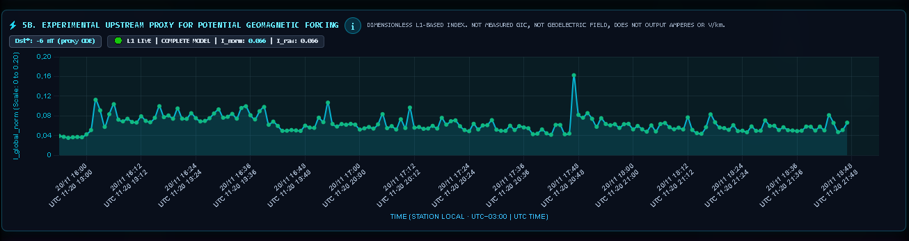

# AlertaSolar

**Standalone heliophysical observation, probabilistic CME propagation and experimental geo-electrical situational awareness**  
**Author and project director:** **Carlos Eduardo Francheri** — Geologist; independent SCADA developer specializing in solar photovoltaic applications  
**Distribution:** Self-contained HTML5/JavaScript · **License:** MIT for original project code; third-party notices retained  
**Get the application:** [GitHub Releases](https://github.com/CEF-SOLAR/SOLARALERT/releases) · [Release history](CHANGELOG.md)

*Conceptual illustration of the workflow, not an operational screenshot. Graphics and numerical annotations are illustrative, not observed measurements or validation results.*

## Purpose and scientific boundaries

**AlertaSolar is an independent scientific-exploration and early-warning workstation**, intended to bring solar activity, heliospheric propagation, upstream solar-wind observations, geomagnetic response and location-dependent subsurface electrical context into one auditable interface. It is relevant to education, research exploration and operational awareness of electricity networks and pipelines.

**It is not an official NASA, NOAA or ESA product.** It does not directly calculate measured geomagnetically induced currents (GIC, A), measured geoelectric fields (V/km), pipe-to-soil potential or a validated probability of equipment damage. Its local indices are **experimental, dimensionless diagnostics**, not physical measurements. AlertaSolar does not replace industrial protection equipment, calibrated instrumentation or agency forecasts.

## Operational workstation

*Actual HMI screenshot showing a historical operational state. It is not a live report of current space-weather conditions.*

The self-contained application combines NASA/NOAA observations, CME tracking in a 3D heliospheric environment, model/observation comparisons, tactical charts, source-status indicators, bounded historical records and SCADA-style alerts. A single local HTML file contains the interface, embedded modeling assets and scientific help panels. **Fresh telemetry, map tiles and outbound mobile notifications still depend on connectivity.**

## Physical models and traceability

| Component | Implemented approach | Interpretation and limitation |
|---|---|---|
| CME travel | **P-DBM** drag-based ensemble; up to **10,000 seeded realizations**, with P10/P50/P90 arrival estimates when a valid ensemble is available | Probabilistic *model output*, not guaranteed arrival times |
| Ambient solar wind | Quality-controlled **27-day L1 history** for the speed prior, with recent-data and fallback options | Missing or insufficient histories must be identified; priors introduce uncertainty |
| Model comparisons | Official **WSA-ENLIL** output distinguished from internal P-DBM predictions and revised DONKI CME records | Comparisons alone do not demonstrate improved predictive skill |
| Magnetospheric context | Newell coupling, Shue magnetopause model and a reconstructed **`Dst*`** proxy following O'Brien & McPherron | The Dst\* proxy is not a measured or officially issued Dst index |
| Geology and EM response | **CRUST1.0/LITHO1.0**, global **1° × 1°** grid (64,800 cells), layered **Wait (1954) 1D** impedance model | Regional approximation; not a site-specific 3D conductivity reconstruction |
| Geomagnetic stations | Location-aware selection of **up to four** available INTERMAGNET/NRCan observatories | Station readings are not measurements at the user's chosen coordinates |

Inputs, provenance, source age, gaps and revisions should remain distinguishable from modeled or interpolated output. Seeded calculations support repeatability **under the same inputs and software state**; they are not a substitute for independent scientific validation.

## Global forcing versus local susceptibility

AlertaSolar separates two internal, dimensionless quantities:

- **`I_Global`** (`I_global,norm`) represents a normalized upstream forcing proxy based on solar-wind/geomagnetic terms: Newell coupling, L1 magnetic-field derivative, modeled `Dst*` and dynamic pressure. The implemented fixed nominal weights are **0.35 / 0.35 / 0.20 / 0.10**. Missing terms are not silently reweighted; incomplete results are flagged or withheld.
- **`R_Local`** applies modeled geo-electrical and latitude-dependent factors to that forcing proxy, producing an operational index bounded to **[0, 1]**.

$$
R_{\mathrm{local,raw}} = I_{\mathrm{global,norm}}\,\Psi_{Z,1D}\,\Phi_{\mathrm{lat}}
$$

$$
R_{\mathrm{local}}=\min\!\left(1,\max(0,R_{\mathrm{local,raw}})\right)
$$

The unsaturated `R_local,raw` is retained separately as a diagnostic. A displayed `R_Local = 1` denotes **scale saturation, not maximum physical severity**. WATCH / ALERT / CRITICAL reference levels (**0.30 / 0.60 / 0.90**) are internal operational thresholds, **not observationally calibrated hazard thresholds**.

## Geological and local-observation workflow

*Conceptual geo-electrical workflow. Geological layers, values and timings in this infographic are illustrative; it is not a measured geological profile.*

*Actual initialization interface: geographic point, geological context and available regional magnetometer selection.*

The embedded 1° grid supports automatic layer selection. Operators can also test **hypothetical near-surface lithology scenarios** by replacing the upper **10 km** with a prescribed resistivity while retaining the deeper modeled profile. Several independent installations may be configured at different points along a pipeline corridor to compare **relative modeled indices**. This cannot resolve fine-scale lateral facies boundaries or establish cathodic-protection performance, corrosion risk or pipe-to-soil potentials. Those require observations and asset-specific electrical modeling.

## Selected tactical observations

**Solar X-ray activity and attribution**

*Actual HMI capture: GOES X-ray activity, HF blackout reference bands and event attribution where available.*

**Global upstream forcing (`I_Global`)**

*Actual HMI capture, with local-time and UTC references. Not a plot of measured GIC.*

**Local geo-electrical susceptibility (`R_Local`)**

*Actual HMI capture. The displayed index is bounded and experimental; its numerical alert levels have not been established as physical damage thresholds.*

## Evidence needed for independent assessment

The system offers models and diagnostic displays; **their predictive skill must be established from evidence, not from feature counts or ensemble size**. A defensible evaluation would publish a fixed retrospective event set and time-stamped inputs, observed shock-arrival times, the corresponding ENLIL/other baselines, and reproducible P-DBM outputs. Relevant measures include arrival-time **MAE and bias**, **P10–P90 interval coverage**, missed events, false alerts and warning lead time. For the geo-electrical indices, observational calibration and uncertainty analysis are needed before any operational hazard interpretation.

**No numerical accuracy, lead-time advantage or independent validation claim is asserted by this README.** Embedded checks and runtime monitoring demonstrate available test mechanisms, not certification or external verification. The distinction among direct observations, agency model products, internal calculations and hypothetical geological scenarios is central to the project.

## Resilience and quick start

1. **Download** a versioned standalone `.html` file from [Releases](https://github.com/CEF-SOLAR/SOLARALERT/releases). The release asset identifies the specific build; this README intentionally does not name a particular version.
2. **Open locally** in a current Chrome or Edge browser. Select the observation point with the map or geographic coordinates.
3. **Configure NASA access.** The shared `DEMO_KEY` permits limited testing but has strict rate limits. For routine monitoring, obtain a free personal key at [NASA Open APIs](https://api.nasa.gov/) and enter it in the application's **NASA API KEY** field. Never commit private keys to the repository.
4. **Start the station** and verify data-source status. Local calculations can use retained information during outages, but **offline operation does not create new satellite observations or deliver network notifications**.

The HMI includes optional `ntfy` push notifications, source-age indicators, telemetry-gap handling, bounded local histories and synthetic educational simulations clearly distinguished from real events.

## Authorship, licensing and data attribution

**Carlos Eduardo Francheri** conceived and directs the project, its scientific objectives and engineering scope. Generative AI tools have assisted with selected programming, debugging, analysis and documentation. **AI assistance is neither scientific peer review nor independent model validation.**

The original project code is offered under the MIT license. Embedded libraries retain their respective licenses and notices. Data/products originate from organizations including **NASA DONKI/CDAWeb, NOAA SWPC, INTERMAGNET, NRCan, CRUST1.0 and LITHO1.0**; the MIT license does not supersede their individual data-use terms. See [INTERMAGNET data conditions](https://intermagnet.org/data_conditions.html) and [NRCan geomagnetic information](https://www.spaceweather.gc.ca/data-donnee/geomag/sd-en.php).

## Resumen (español)

**AlertaSolar** es una estación HMI independiente de observación heliofísica, propagación probabilística de CMEs y evaluación **experimental** del contexto geoeléctrico local. Integra telemetría espacial, modelos físicos, geología global y observatorios geomagnéticos regionales. Los índices `I_Global` y `R_Local` son **adimensionales y no equivalen a GIC medidas, campos eléctricos observados ni probabilidades validadas de daño**. La operación local puede continuar parcialmente con datos retenidos, pero los nuevos datos y las notificaciones externas requieren conectividad. El proyecto reconoce explícitamente sus incertidumbres y la necesidad de validación retrospectiva independiente.
