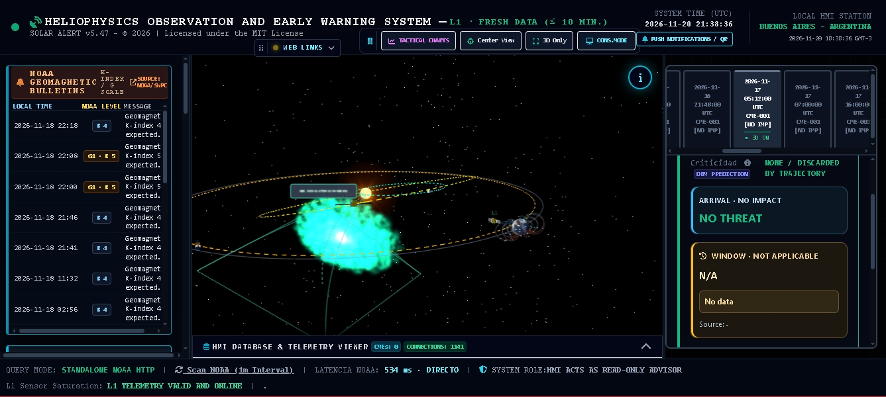
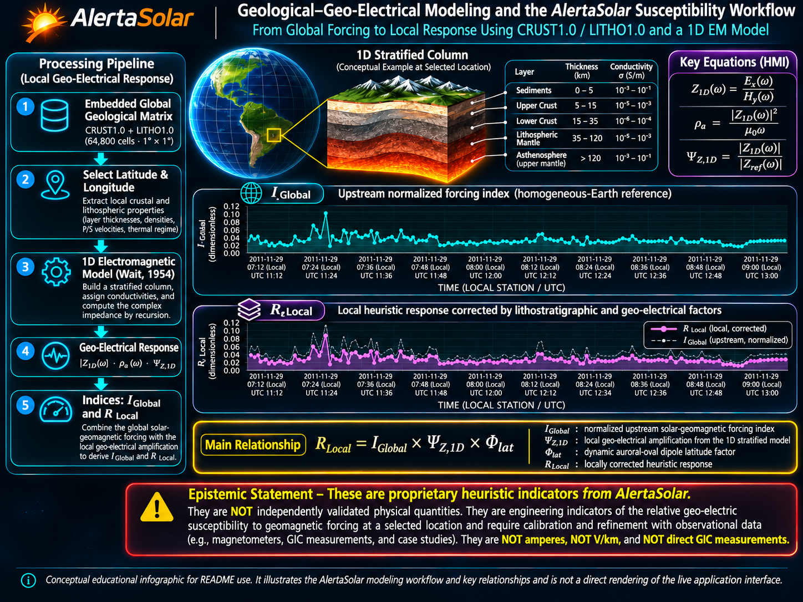
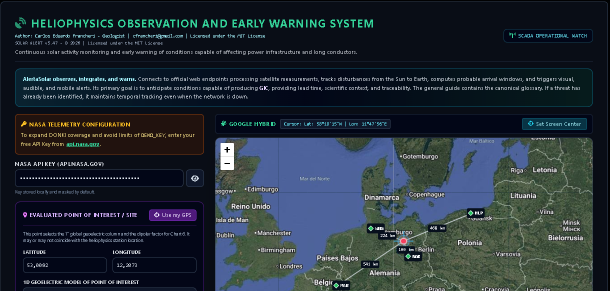
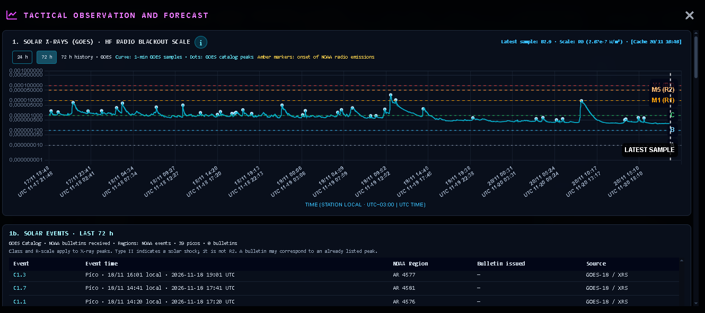

# AlertaSolar

**Autonomous Heliophysical Observation, Geophysical Modeling & Early Warning — SCADA-Style HMI**  
**Author and scientific/engineering director:** **Carlos Eduardo Francheri** — Geologist · Independent SCADA developer specializing in solar photovoltaic energy  
**Distribution:** Self-contained, offline-first HTML5 / JavaScript  
**License:** MIT; embedded third-party components retain their original licenses  
**Versioned downloads:** [All releases](https://github.com/CEF-SOLAR/SOLARALERT/releases) · [Latest published release](https://github.com/CEF-SOLAR/SOLARALERT/releases/latest) · [Revision history](CHANGELOG.md)

*Each AlertaSolar HTML distribution keeps its explicit version in its filename (for example, `AlertaSolar_V5_EN_5.48.html`). No generic replacement filename is used.*

*Conceptual overview, not a live software screenshot. Drawn structures, plots and numerical values are illustrative; the project's local susceptibility indicator is experimental and requires observational calibration.*

### Engineering rationale — Geology and operational SCADA

AlertaSolar combines a geologist's perspective on subsurface electrical structure with practical SCADA engineering principles: continuous acquisition, auditable histories, operational alarms and reliable local operation. Its design is directed by its human author, with software tools—including generative AI—used in supporting roles.

Three concerns shaped AlertaSolar: dependence on remote services during outages; false continuity created by poorly handled telemetry gaps; and space-weather assessments that overlook the crustal and geo-electrical conditions of the selected observation point.

AlertaSolar brings together solar activity, heliospheric propagation, upstream L1 observations, magnetospheric coupling and a location-dependent geo-electrical model. It is designed for **scientific exploration, education and operational situational awareness**—including the context of power networks and pipelines—without claiming to calculate currents in actual infrastructure.

A single HTML file bundles its visualization and calculation libraries, an embedded global geological grid and its scientific help panels. Internet access is needed for **new external telemetry, map tiles and outbound mobile notifications**, but the application can continue selected local calculations from previously retained observations when connectivity is disrupted.

## 1. Operational interface

*Actual HMI screenshot: 3D heliospheric scene, NOAA bulletins, telemetry provenance and operational panels. The display represents a historical application state, not current conditions.*

The interface combines NASA/NOAA data products, 3D CME tracking, tactical plots, bounded local histories, source-quality indicators and SCADA-style event logs. It is an **independent advisory workstation**, not a replacement for an industrial protection system or a direct interface to plant PLCs and RTUs.

## 2. Scientific scope and index definitions

**AlertaSolar does not calculate measured GIC in amperes or geoelectric fields in V/km.** Such estimates require appropriate regional magnetic-field data, conductivity structure and asset-specific electrical topology. It also does not predict infrastructure damage or quantify a validated probability of failure.

The HMI distinguishes two dimensionless, experimental indicators:

- **`I_Global` (`I_global,norm`)** — upstream solar-wind/geomagnetic forcing proxy, combining Newell coupling, an L1 magnetic-field derivative, modeled Dst* and proton dynamic-pressure terms. Valid components use fixed weights **0.35 / 0.35 / 0.20 / 0.10**, with component and final normalization to **[0, 1]**. Missing terms are not reweighted; eligible partial results are marked provisional, and insufficient evidence produces no value.
- **`R_Local`** — locally modified heuristic susceptibility indicator. The geo-electrical multiplier comes from a layered 1D impedance model, and a separate factor represents dipolar/auroral latitude dependence.

The **implemented numerical distinction** is:

$$
R_{\mathrm{local,raw}} = I_{\mathrm{global,norm}}\,\Psi_{Z,1D}\,\Phi_{\mathrm{lat}}
$$

$$
\boxed{R_{\mathrm{local}}=\min\!\left(1,\max(0,R_{\mathrm{local,raw}})\right)}
$$

`R_local,raw` preserves the product without saturation as a **diagnostic**; the operational curve, levels and notifications use the **bounded `R_local` value**. A displayed value of 1 denotes **saturation of an internal HMI scale**, not maximum physical severity, measured GIC or a 100% damage probability. WATCH / ALERT / CRITICAL thresholds (0.30 / 0.60 / 0.90) and their hysteresis are internal operational choices, **not independently validated physical thresholds**. Both indicators require empirical calibration.

## 3. Core physical and prediction engines

- **CME propagation:** A drag-based P-DBM ensemble requests 10,000 deterministic realizations, applies input/realization checks and reports P10/P50/P90 arrival windows when a valid ensemble is available. Results depend on the selected CME revision, geometry and wind/drag priors; they are not guaranteed arrival times.
- **Reproducibility and provenance:** Canonical input snapshots and seeded pseudorandom sampling support repeated calculations under identical conditions. DONKI CME measurement revisions and official WSA-ENLIL products remain distinct from AlertaSolar's model output.
- **Background solar wind:** A quality-controlled 27-day L1 archive supports the ambient-speed prior, including a recent six-hour mean when coverage permits. A separate real-time option uses median/MAD; empirical fallback is explicitly identified when archive coverage is insufficient.
- **Magnetospheric response:** The HMI incorporates Shue magnetopause compression, Newell coupling and a reconstructed **Dst* proxy using O'Brien & McPherron (2000)**. The proxy is modeled, **not an official measured Dst index**.
- **Continuity controls:** Satellite provenance, gaps, handovers, stale records and unavailable values are surfaced rather than silently represented as continuous measurements.

## 4. Global geology and regional geomagnetic context

The offline HTML embeds a **180 × 360 global grid (64,800 cells; 1° × 1°)** derived from **CRUST1.0 and LITHO1.0**. Selecting latitude and longitude retrieves the local modeled layer structure and published conductivity priors. A **Wait (1954) 1D stratified electromagnetic recursion** estimates surface impedance and apparent resistivity at the HMI reference period; this is a modeled response, not a direct measurement at the selected coordinates.

*Educational schematic, not a screenshot or a plot of measured geological columns. Layer values and timelines are illustrative. The actual operational `R_Local` is capped at [0, 1] as specified in Section 2.*

*Actual initialization screen: location selection, geological context and automatic selection of **up to four** available regional geomagnetic stations. The network cannot guarantee four enclosing online observatories at every location.*

The program evaluates great-circle distance, azimuth, station availability and regional geometry. **INTERMAGNET/NRCan observations belong to their own stations**; selection of nearby stations is not equivalent to directly measuring or interpolating the magnetic field at the user's point.

**Distributed pipeline-corridor assessment.** Independent AlertaSolar workstations may be assigned to different observation points along a pipeline, allowing operators to compare location-specific modeled `R_Local` values. At each station, the lithology dropdown can use the **automatic 1° global CRUST1.0/LITHO1.0 profile** or a **manual hypothetical scenario** that replaces the upper 10 km with a prescribed resistivity layer while retaining the deeper modeled structure. This supports comparative *heuristic* assessment across geological settings; it does **not** resolve fine-scale lateral conductivity contrasts, measure pipe-to-soil potentials, quantify cathodic-protection performance or locate corrosion defects. Direct field measurements and asset-specific modeling would be necessary for those purposes.

## 5. Tactical observation and forecast suite

The HMI's eight numbered chart groups cover GOES solar X-rays and HF blackout references; magnetopause compression; L1 observations versus WSA-ENLIL forecasts; observed/forecast Kp; L1 transit time; global forcing; local heuristic susceptibility; regional magnetometer variation; and energetic electrons at geostationary orbit. The 5A/5B subpanels expand the numbered suite. The screenshots below are **examples**, not a complete user manual.

**Solar X-rays and event attribution — Chart 1 / Table 1b**

*Actual historical HMI screenshot: GOES X-ray observations, HF radio-blackout reference levels and event attribution when available.*

**Global upstream forcing — Chart 5B**

*Actual HMI chart of `I_Global`; the horizontal axis displays station-local time and UTC. This is not a measured GIC current.*

**Local geo-electrical susceptibility — Chart 6**

*Actual HMI chart of `R_Local`, with lithostratigraphic/dipolar factors, local and UTC timestamps, and internal WATCH reference. The index remains experimental and uncalibrated.*

## 6. Resilience, alerting and educational use

- **Local continuity:** Retained CME and L1 inputs support certain 3D, propagation and countdown functions when NOAA/NASA links are unavailable. The HMI marks missing or aged telemetry; it does **not** generate new satellite observations offline.
- **Bounded storage and verification:** Browser storage uses bounded histories (including a nominal 48-hour L1 rolling window). Embedded regression checks and a 24-hour performance monitor provide *test mechanisms*, not universal proof of flawless operation or zero leaks.
- **Group notifications:** An optional `ntfy` workflow uses mobile subscriptions, station identification, guarded triggers and delivery coordination across tabs. Sending notifications **requires network availability**; triggers and cooldowns are operational settings.
- **Scientific transparency:** The `[i]` HUD panels expose equations, assumptions, variables, DOI references and physical limitations. An accelerated CME simulator is identified as **synthetic educational content** and is separated from the observational record, with a safety interlock for critical live events.

## 7. Download and quick start

1. **Choose your version.** Open [AlertaSolar releases](https://github.com/CEF-SOLAR/SOLARALERT/releases) and download the versioned `.html` file you want (for example, `AlertaSolar_V5_EN_5.48.html`). The filename identifies the exact build. The releases page becomes available for downloads when the first release is published; the README and images alone are not the application.
2. **Open the HTML.** Double-click the downloaded file and open it in a current browser such as Chrome or Edge. No installer, build process or cloud-hosted interface is needed. On the opening screen, choose the observation point using the map or latitude/longitude; AlertaSolar loads its local geological context and selects available regional magnetometer stations.
3. **NASA API key — demonstration or personal use.** AlertaSolar can be tried with the shared **`DEMO_KEY`**, which has strict request limits. **For regular monitoring, obtain your own free NASA API key at [NASA Open APIs](https://api.nasa.gov/)** and enter it in the **NASA API KEY** field on the opening screen. Never publish a personal API key in the repository.
4. **Start the station.** Press **START** and complete the entry confirmation. New satellite data and outbound mobile notifications require an internet connection; some local functions can continue from retained inputs during outages.

**Version history:** See [CHANGELOG.md](CHANGELOG.md) for the exact distribution filename, date and concise changes recorded for each documented version. Release files retain their original names; this README remains version-independent.

---

## 8. AI-assisted development and epistemic transparency

**Human authorship and direction:** Carlos Eduardo Francheri defines AlertaSolar's scientific objectives, engineering requirements and operational scope. Generative AI tools have supported selected programming, debugging, analysis and documentation tasks, including README drafting. **AI assistance is not independent scientific validation.** Models, code behavior and numerical claims remain subject to reproducible testing, published literature and observational calibration.

**The project distinguishes physical measurements, agency forecasts, internal models and heuristic indicators.** None should be interpreted as an official NASA/NOAA certification or an instrument-based GIC measurement.

## 9. Licensing, data and attribution

Original AlertaSolar code is released under **MIT**. Embedded third-party software retains its own licenses, including Three.js and Chart.js (MIT), Leaflet (BSD-2-Clause), KaTeX (MIT/OFL for fonts), Marked (MIT), Tailwind CSS (MIT) and Font Awesome Free (component-specific MIT/OFL/CC BY 4.0). Review the bundled license notices when redistributing the monolithic HTML.

Scientific/data sources include **NASA DONKI/CDAWeb, NOAA SWPC, CRUST1.0, LITHO1.0, INTERMAGNET and NRCan**. Their original attribution and usage terms remain applicable; in particular, external geomagnetic observations are not relicensed by AlertaSolar's MIT license. See [INTERMAGNET data conditions](https://intermagnet.org/data_conditions.html) and [NRCan geomagnetic data information](https://www.spaceweather.gc.ca/data-donnee/geomag/sd-en.php).

## 10. Resumen breve (Español)

**AlertaSolar**, creado y dirigido por **Carlos Eduardo Francheri**, geólogo y desarrollador de sistemas SCADA especializados en energía solar fotovoltaica, es una HMI monolítica de observación heliofísica y alerta temprana, con simulación educativa, propagación probabilística de CMEs, seguimiento de telemetría L1 y contexto geofísico local mediante CRUST1.0/LITHO1.0 y observatorios geomagnéticos regionales. Distingue el forzamiento normalizado `I_Global` de la susceptibilidad heurística corregida `R_Local`; el valor operativo está limitado a **[0, 1]**, mientras que el diagnóstico sin saturación se conserva por separado. **Estos índices no representan corrientes GIC medidas, V/km ni probabilidades validadas de daño.** El sistema puede mantener determinadas funciones locales durante cortes de conectividad, pero no obtener observaciones nuevas ni entregar notificaciones externas sin red. Sus modelos y umbrales requieren evaluación y calibración independiente.
